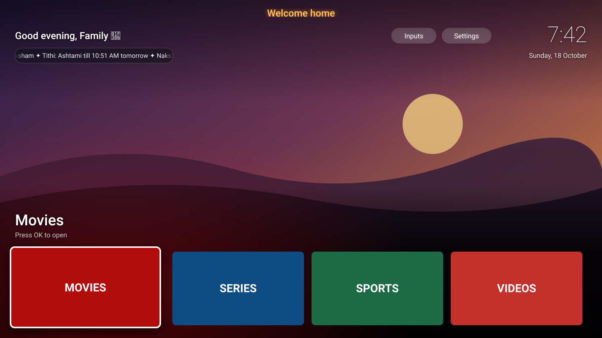

# FamTV

**Turn a cluttered, ad-filled Android TV into a calm home screen your family actually likes.**

FamTV replaces the stock Android TV launcher with a tiny native home screen and switches off the
bloat, all over Wi-Fi from your laptop. No root, no Play Store, no Gradle, nothing uninstalled, and
everything can be undone with one command.


<sub>Illustration with placeholder apps. On a real TV the background is your own family photo.</sub>

## Features

**Home screen** (`launcher/`, a ~30 KB APK, no network permission)
- **Your family photo** as the background, with a scrim that keeps faces clear of the text.
- **"Good morning, <name>"** with an icon for the time of day: ☀️ morning, 🌤️ afternoon, 🌆 evening, 🌙 night.
- **Optional header line** centred at the top, e.g. a blessing, in saffron gold.
- **Big favourites row**, plus every other app in a grid. The background glow takes the colour
  of the focused app.
- **Telugu panchangam ticker**: samvatsaram, masam, paksham, tithi and nakshatram with end
  times, in Telugu script or English. Computed on the TV from lunar and solar positions (Meeus,
  Lahiri ayanamsa, IST), so it works offline. Checked against published panchangams to within
  about a minute.
- **Inputs and Settings buttons**: one press to HDMI, the antenna or system settings.
- **D-pad navigation** that always goes where you expect, with large focus rings for older eyes.

**Debloat** (`tools/debloat.sh`)
- Switches off ad trackers (e.g. Samba TV content recognition), promo apps and the stock
  launcher's recommendations. Apps are *disabled*, never removed. `tools/restore.sh` brings back
  the stock TV.

**tvctl** (`tools/tvctl.py`)
- A small network-ADB client in Python for screenshots, remote key presses, shell commands and
  file transfers with checksums. It works where macOS blocks the stock `adb` binary.

## How it's built

- The launcher is plain Java with programmatic views, built straight from the Android SDK:
  `aapt2 → javac → d8 → zipalign → apksigner`. See `launcher/build.sh`; it builds in seconds.
- Personal settings are an Android resource overlay, layered over generic defaults at build
  time, so household details never touch the source tree.

## Your details stay local

Everything specific to your household goes in `private/`, which is git-ignored and never pushed:

| File | What | Start from |
|---|---|---|
| `private/tv.env` | `TV_HOST=<the TV's IP>` | — |
| `private/launcher.xml` | greeting name, header, favourites, hidden apps, panchangam on/off | `examples/launcher.xml` |
| `private/devices/<tv>.txt` | what to switch off on your TV | `examples/debloat.txt` |

Backups (`backups/`), the ADB key (`tools/.keys/`), screenshots and photos are git-ignored too.

## Setup (once)

```bash
brew install openjdk@17 android-commandlinetools
JAVA_HOME=/opt/homebrew/opt/openjdk@17 sdkmanager "platforms;android-34" "build-tools;34.0.0"
python3 -m venv tools/venv && tools/venv/bin/pip install adb-shell rsa
mkdir -p private/devices && echo "TV_HOST=<tv ip>" > private/tv.env
cp examples/launcher.xml private/launcher.xml
cp examples/debloat.txt private/devices/mytv.txt
```

On the TV: Settings → About → press **Build** 7 times, then Developer options → **USB / ADB
debugging** on. Accept the "Allow debugging?" prompt the first time you connect.

## Use

```bash
tools/tv info                                     # model / Android version
tools/tv shot home.png                            # screenshot
tools/tv key DPAD_DOWN DPAD_CENTER                # press remote buttons

tools/debloat.sh private/devices/mytv.txt         # switch off the bloat
launcher/install.sh private/devices/mytv.txt      # build + install + make it home
tools/restore.sh private/devices/mytv.txt         # back to 100% stock

tools/set-background.sh ~/Pictures/photo.jpg      # photo behind the tiles (jpg/png/heic)
tools/set-background.sh --clear                   # back to plain black
```

After editing `private/launcher.xml`, run `launcher/install.sh` again.

To bring back a single app: `tools/tv sh 'pm enable <package>'`, or on the TV go to
Settings → Apps → (app) → Enable.

## Good to know

- Everything runs on the TV. Your laptop is only needed to install or change things.
- When you're done, turn **ADB debugging off** on the TV. The home screen stays.
- Keep `~/.android/famtv-debug.keystore`. Updates must be signed with the same key.
- If a system update or a factory reset brings back the stock home screen, run
  `launcher/install.sh` again.

## License

MIT
